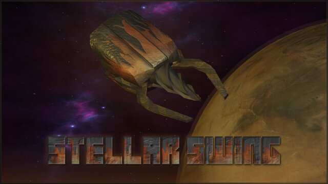
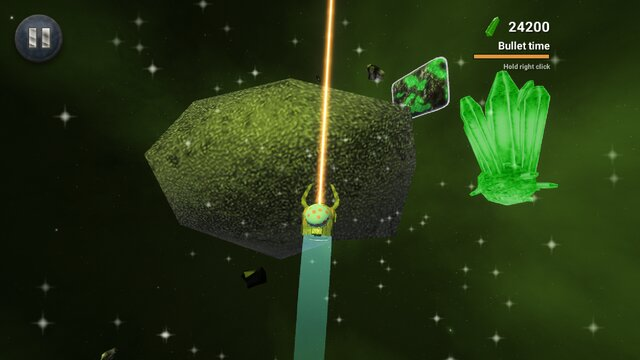
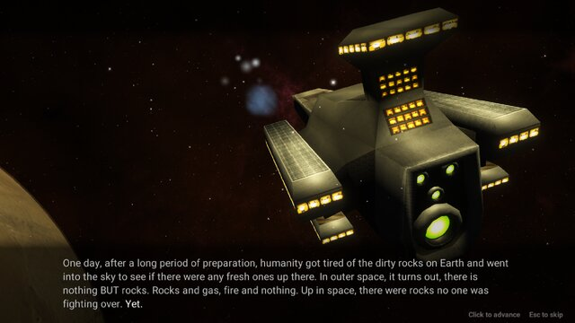
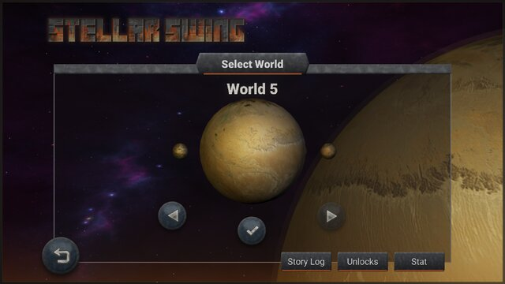
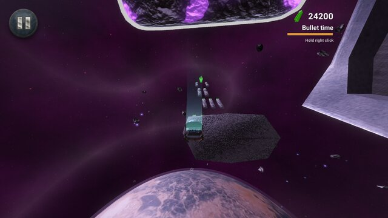
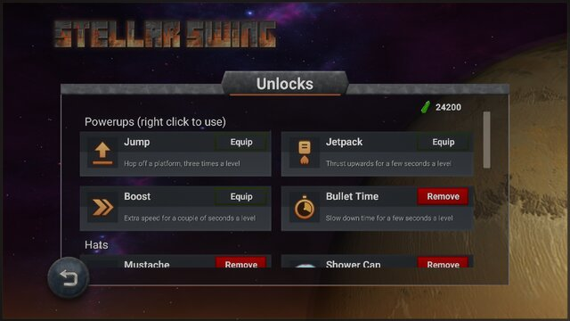

# Stellar Swing

A velocity driven swingy space game. You fly a little mining drone with a grappling laser,
and swing from asteroid to asteroid collecting picolinium crystals so the Stellar Flame
has enough fuel to finish its journey. It's all about when you grab on, when you let
go, and how much speed you can carry between the two.

You can get it on [Steam](https://store.steampowered.com/app/1319990/Stellar_Swing/) for
Windows, Mac and Linux.

## A bit of history

We founded [Pillowdrift](https://pillowdrift.com/) while we were studying Computer Games
Programming at the University of Derby. We took a gap year to make games full time, and
Stellar Swing was one of the games we made, first released in 2013 on PC and Android.

This repository is the remaster. We started it in 2020 with a Steam release in mind, got
most of the way there and then shelved it for a few years, and in 2026 I finally picked
it back up and finished it off. It's been moved up to Unity 6 and has a new UI, a
proper story told between worlds, a shop with powerups and hats, and lots of smaller
fixes and polish. There are a few stretch goals left but it's pretty much done.

## Features

- 45 levels across five worlds, all open ended, so there's usually more than one way
  through
- Mouse controls: click to grapple, let go to fling yourself off, and drag to nudge
  your trajectory
- A story between each world, written by Sky Leviathan
- Picolinium to spend on powerups (jump, jetpack, boost and bullet time) and a
  slightly silly selection of hats
- A crown if you can finish the whole game in under an hour
- Steam achievements
- An original soundtrack by Campbell Logan
- Graphics settings for all the fancier effects, so you can turn them down on an older
  machine

## Building it

Open the project in Unity 6.3 (6000.3.26f1), then use Stellar Swing > Build All from the
menu bar to build for Windows, Mac and Linux into `Builds/`. Steam only initialises if
the Steam client is running.

## Credits

Made by Caitlin Wilks, Jitesh Rawal, Richard Webster-Noble, Maisy Livingston and Sky
Leviathan, with original artwork by Tom Duke and Joe Brammer and music by Campbell Logan.
Sound effects from Freesound.org (Black Boe, DJ Chronos and sandyrb).
